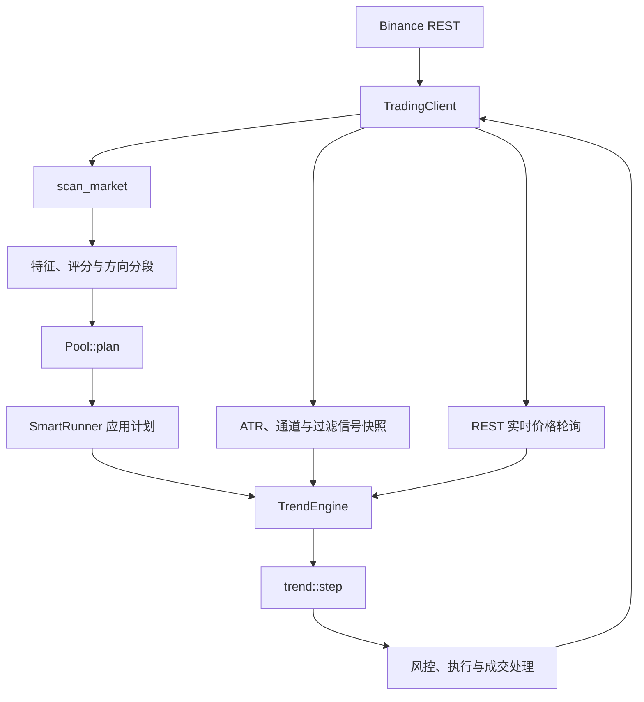

# 趋势跟踪框架与升级基线

> 后续升级：当前趋势算法与风险预算见 [趋势跟踪 V1](TREND_FOLLOWING_V1.zh-CN.md)，本文保留框架清理阶段的结构说明。

更新日期：2026-10-31。上游基线为 CCBot v5.11.0，提交 `f740fd8f6851bc5fbac100dcde1a6e9faa2d1c15`。本次整理与升级作为独立项目 [TradingBot](https://github.com/MrF-crypto/TradingBot) 的 v1.0.0 发布；保留上游提交历史与 MIT 许可。

## 本轮收敛范围

智能模式只保留原唐奇安突破策略，统一命名为“趋势跟踪”，核心枚举为 `trend::Strategy::TrendFollowing`。智能层不再需要策略选择枚举。

已移除：智能裸K埋伏、点火判定、波动顺势、专用参数、选币扫描、池状态、策略切换、专用 GUI 页面、强制点火开仓接口、波动顺势反手逻辑、专用记录与对应失效测试。

手动策略的抛物线 SAR 和纯裸K继续存在。趋势评分仍需的 κ 计算、加密币标的过滤、行情、限流、交易适配和持仓保护继续共用。

## 模块边界

| 层 | 代码入口 | 职责 |
| --- | --- | --- |
| GUI / headless | `src/gui/`、`src/headless/main.cpp` | 设置、装配、调度和展示 |
| 智能执行 | `src/app/smart_runner.*` | 扫描数据、执行候选池计划、同步出场参数 |
| 智能纯逻辑 | `src/core/smart_mode.*` | 门槛、特征、评分、分段、候选池、JSON |
| 策略决策 | `src/core/trend_decision.h` | 根据 Config / State / Inputs 生成交易动作 |
| 指标 | `src/core/indicators.h` | ATR、实体唐奇安通道、量比、效率比 |
| 引擎 | `src/core/trend_engine.*` | 仓位、执行、闸门、灾难止损和对账 |
| 交易所 | `src/core/itrading_client.h`、`src/net/trading_client.*` | 可替换交易接口、Binance REST 实现 |
| 行情 | `src/net/rest_price_feed.*`、`rate_gate.*` | 标记价轮询、新鲜度、兜底、限流 |
| 持久化 | `src/headless/trend_state.*`、`src/gui/trend_panel.cpp` | 运行状态保存与恢复 |
| 记录 | `src/core/journal.*` | 交易、扫描、候选池、过滤 CSV |
| 测试注入 | `src/core/engine_host.h` | 可注入时钟和执行器 |

GUI 和 headless 共用 CMake 的 `CORE_SOURCES`。后续行为升级应落在共用层，避免出现两套策略实现。



选币只创建常驻 bot，不直接开仓。自动 bot 加入后先等价格回到通道内完成上膛，再识别突破。

## 当前策略参数与语义

| 项目 | 智能模板默认 |
| --- | --- |
| 周期 / 通道 | 1h / 12 根已收盘实体通道，排除当前根，不按影线 |
| ATR / 止损 | ATR14 / 3 倍 ATR 的 Chandelier 棘轮止损 |
| 箱体 / 趋势例外 | 4 ATR / 效率比 0.4 |
| 突破量比 | 1.5，按当前根已走时间折算；弱势段单独配置、过热段不要求 |
| 追高 | 离通道边沿超过 1.5 ATR 不开仓 |
| 同根开仓 | 每根最多一次 |
| 假突破 | 多单默认开启，空单默认关闭 |
| ATR 锁定 / 加速收紧 | 默认开启 |
| 自动 bot 反手 | 禁止即时反手 |
| 交易所灾难止损 | 强制开启，默认外扩参数 0.2% |
| 同时持仓数 | 默认 20，手动和自动一起计数 |

默认方向模式是 Mixed：强势仅多、弱势仅空、中间多空、过热仅空，再与允许的多空方向取交集。也支持 Breakout 名单。正常下次扫描为整点后 1 分钟；失败后 5 分钟重试。

候选池默认以 1.5 倍排名边界、连续 2 轮掉出、驻留 24 小时做滞回。数据未知不判不合格，持仓和在途订单不因排名而被移除。

选币使用已收盘 1h K 线；交易信号中的 ATR 包含当前根，通道仍排除当前根，箱体过滤另用已收盘 ATR。升级时需要明确每个数据口径。

本地止损会向有利方向推进，交易所灾难止损保留初始保护位置。OI 和主动买入占比用于记录，当前 OI 不参与选币决策、主动买入占比不参与评分。

## 配置、状态与构建契约

- 新名称为 `trend_following`，旧 `turtle` 输入兼容；智能配置写出不再包含 bare / vol 参数块。
- 智能策略 bare / vol 及未知名称、错误类型会被拒绝，校验失败不修改调用方原配置。
- 旧 K / V 自动 bot 若仍有持仓，GUI 和 headless 都拒绝启动交易并保留原状态；旧空仓条目可丢弃。
- GUI 与 headless 的原状态路径保留，避免更名导致仓位恢复断档。
- 仅构建 headless 时使用 `CCBOT_BUILD_GUI=OFF`。vcpkg 另加 `VCPKG_MANIFEST_NO_DEFAULT_FEATURES=ON`，才会同时省去 Qt 依赖。
- Qt 不启用默认功能集，只保留 Widgets、线程、正则和 PNG。simdjson、curl、MbedTLS、线程仍是生产路径必要依赖。
- 所有既有测试目标注册为 CTest，17 套测试的名称与 sanitizer 列表保持一致。

## 后续升级入口

选币因子、权重和方向分段改 `smart_mode`；候选池准入淘汰改 `Pool::plan`；入场与出场改 `trend_decision`；信号口径改 `indicators` / `TradingClient::fetch_trend_signal`；执行状态改 `trend_engine`。

新增参数时同步模板、JSON 校验与往返、GUI 表单、`same_params`；持仓中可修改的出场项另接 `update_exit_params`。新增运行状态需要同步 GUI / headless 持久化，并验证重启行为。

需要保持：账户闸门不拦出场、平仓失败不继续开反向仓、未知订单不盲重试、未知数据不当作不合格、持仓不因淘汰失去管理、止损不向不利方向回退。

独立发布前再确定项目名、版本、新仓库地址和历史保留方式，保留 MIT 声明，运行跨平台 CI 和发布包泄漏检查。本轮未创建远程仓库或发布版本。

## 本轮验证结果

- Windows Release 构建完成：`TradingBot.exe`、`ccbot_headless.exe` 和全部测试目标，启用 `CCBOT_WERROR=ON`。
- CTest 全部 **17/17** 通过；智能扫描执行层另做 **20 次连续运行**检查通过。
- `tools/check_suite_coverage.py` 通过：17 个目标列入 ASan，6 个目标列入 TSan。这里只核对了门禁列表，本轮未运行 sanitizer 或跨平台 CI。
- 单独配置 `CCBOT_BUILD_GUI=OFF` 成功，未查找 Qt。
- `git diff --check`、示例配置和可选 GUI 依赖结构检查通过。

本机原 MinGW GCC 16.1 工具链在线程退出时存在可独立复现的 TLS 清理崩溃；最终验证改用项目私有的匹配工具链 GCC 16.2.0，未为此改动交易逻辑。构建依赖只解压在被 Git 忽略的 `build/deps/`，没有更改系统安装。

构建产物位于 `build/verified/`，日志为 `build/verified-tests.log` 和 `build/verified-runner-repeat.log`。测试临时目录指定为 `build/test-tmp/`，避免当前沙箱对系统临时目录文件轮换的限制。

本机复现命令（PowerShell，在仓库根目录）：

```powershell
$env:PATH = "$PWD\build\deps\mingw64\bin;$env:PATH"
cmake -S . -B build/verified -G Ninja -DCMAKE_BUILD_TYPE=Release -DCCBOT_BUILD_GUI=ON -DCCBOT_WERROR=ON "-DCMAKE_CXX_COMPILER=$PWD/build/deps/mingw64/bin/g++.exe" "-DCMAKE_PREFIX_PATH=$PWD/build/deps/mingw64"
cmake --build build/verified --parallel 4
$env:TEMP = "$PWD\build\test-tmp"
$env:TMP = $env:TEMP
ctest --test-dir build/verified --output-on-failure --parallel 2
```
