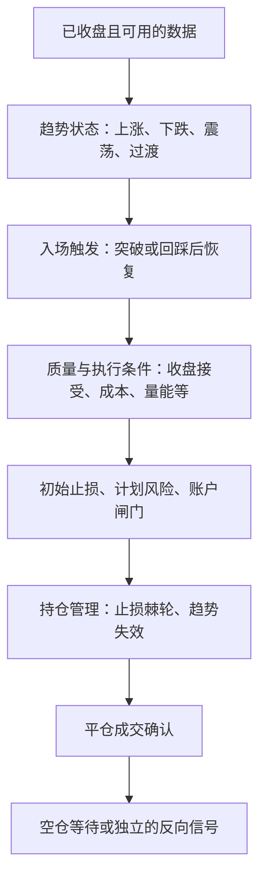

# 趋势跟踪策略设计草案

> 实施状态（2026-10-31）：均线方向、收盘/盘中突破、组合预算与异动唤醒已进入第一版代码，详见 [V1 实现说明](TREND_FOLLOWING_V1.zh-CN.md)。本文其余候选仍为研究设计，不能视为全部实现或已证明有效。

日期：2026-10-31。本文记录策略研究方案，部分已进入 V1，其余仍为候选设计；尚未完成收益验证。公式中的周期和阈值是待检验样例。

## 1. 策略目标

根据已发生的价格、成交及市场状态作出反应，不预设顶部、底部或目标价。争取参与持续趋势的一段，接受确认延迟、连续小亏和部分利润回吐。

通过事先定义的方向、触发、风险预算和退出规则约束交易情绪。空仓是有效状态。过滤器的评价标准是费用后的收益分布和回撤，不是单独追求高胜率或少止损。

横盘本身不等于永远不能交易：箱体内的来回触碰可以不做，而有效离开箱体可能是趋势形成的起点。需要识别“震荡内部”与“震荡向趋势的转换”。

## 2. 当前框架需要优先协调的逻辑

- `smart_mode.cpp::seg_direction()` 将过热段限定为仅空；`classify()` 会因过去一段出现大幅上涨而将标的归入过热段。这不是无条件立即开空，但它用历史涨幅限制了未来交易方向，不适合作为纯顺势方向规则。
- 相对 BTC 跑输不等于该币自身处于下跌趋势，跑赢也不等于自身上涨。相对强弱适合在同方向合格标的中排序；多空许可应来自标的自身的绝对趋势状态。
- 过热、伸展过远和异常波动可以用于暂缓追价、等待回踩或减少准入，不应自动成为反向开仓理由。大跌后也按同样原则处理。
- 现有 ER 主要用于箱体过滤的趋势例外；把它升级为完整的趋势状态读数，与再加入一个 ER 类指标是两件事。
- 选币的 ATR 压缩特征已经存在。新增布林带压缩、CHOP 等高度相关条件前，应检查其增量价值。
- 当前通道按实体计算，信号可盘中触发；收盘确认、高低点通道、回踩入场应作为明确的可比较版本。

## 3. 四层决策与状态



候选状态可以表达为 `Range / UpTrend / DownTrend / Transition`，交易状态另行表达为 `Flat / PendingEntry / Long / Short / PendingExit`。不要将市场状态、持仓状态与名单名次混成一个枚举。

指标缺失是 `Unknown`，不是震荡或反转。缺失数据阻止依赖它的新入场判断，已有仓位继续保留有效保护。

趋势状态采用进出不对称的阈值或连续确认，避免在边界附近频繁换向。反向交易需要平仓确认后重新满足反向入场条件。

## 4. 值得验证的因子

### A. ATR 标准化的均线方向与分离度

示例：

```text
slope = (EMA50[t] - EMA50[t-m]) / (m × ATR14[t])
separation = abs(EMA20[t] - EMA50[t]) / ATR14[t]
```

全部在已收盘的数据上计算。上涨候选可要求快线在慢线上方、慢线斜率为正；下跌镜像。较小的分离度和接近零的斜率可归入震荡或过渡。

ATR 标准化使读数便于跨币种比较。均线长度、斜率回看长度和状态阈值仍需要验证。价格距均线过远用于判断追价成本，不能作为反向信号。

### B. ADX 与 DMI

ADX 衡量方向运动强度，方向另由价格结构、均线或 DMI 判断。可比较固定阈值、ADX 变化、带滞回的状态切换等版本。

ADX 有滞后，趋势反转时也可能仍高；不能解释成 ADX 上升就做多。常见 20 / 25 划分只能作为实验起点，不是加密永续合约的已验证阈值。

建议首先与现有 ER 做替代对照，不把 ADX、ER、CHOP 等全部设为必须同时满足。

### C. 因果确认的道氏结构

上涨结构：已确认的高点和低点依次抬高；下跌结构镜像。可作为趋势许可，也可用最后一个确认的更高低点 / 更低高点定义结构失效。

如果一个摆动点要求右侧两根 K 线确认，那么信号只能在第二根右侧 K 线收盘后使用，不能回填到极值出现的时刻。ZigZag 或摆动点会重绘时，需要保存当时实际可见的状态。

结构识别比均线更直观，但确认滞后和摆动点粒度同样是参数。首版宜把均线方向与结构方向作为两个对照版本。

### D. 突破后的价格接受度

已有“触碰通道”信号可以增加收盘接受度：

```text
long_extension = (close[t] - upper[t-1]) / ATR[t-1]
close_location = (close[t] - low[t]) / (high[t] - low[t])
```

做多要求收盘在旧通道上方，并且收在本根较高位置；做空镜像。振幅为零或数据缺失时不产生有效确认。旧通道、参考 ATR 与突破边沿在判定时冻结，避免突破过程抬高门槛或撑大分母。

可以检验很小的 ATR 突破缓冲与当前追高上限的组合；缓冲不能无限增加，否则只是推迟成交。收盘确认能避免部分盘中冲高回落，也会错过或抬高部分趋势入场成本。

### E. 主动成交方向与 OI 变化

当前框架已记录主动买入占比和 OI。可研究价格方向、连续若干根的主动成交占比与 OI 变化是否为候选信号提供增量信息。

OI 增加意味着未平仓合约增加，每个合约同时有多空双方，不能直接推断净多或净空。主动买入占比也不是净资金流入。价格上涨、OI 下降可能包含空头回补，也可能继续形成有效趋势，不能直接否决。

建议先记录和分组评价，再决定是否参与评分；不宜在第一版就成为强制入场门槛。缺失 OI 不能解释为趋势转弱。

### F. 点差、盘口深度与执行成本

研究读数可包括：点差占价格、点差占初始止损距离、计划数量对应的预估滑点、滑点占 ATR，以及成交量稳定性。

该组因子用于识别信号是否可执行，尤其适合流动性差的山寨币。报价或深度陈旧时不把它当作可成交报价。盘口快照不能保证实际成交价格；加入模型前要先具备相应历史或实时数据。

这与现有 24h 成交额门槛互补：日成交额通过不代表触发瞬间的点差和深度合格。

## 5. 三条可比较的入场路线

### 路线 A：趋势许可 + 通道收盘突破

- 以已收盘的高一级周期确认方向，例如 4h；以 1h 触发。这是待检验的周期组合。
- 信号 K 收盘突破此前 N 根的通道，质量条件通过后，下一根第一笔可执行报价参与下单。
- 实际报价已超出追高限度时放弃，或进入独立的回踩等待状态。
- 不能在回放中用已经观察到的收盘信号，再假设成交于同一根的理想收盘价。

此路线结构简单，适合优先实现。不要额外强制等待同一根同时完成均线金叉、结构转折和长期通道突破。

### 路线 B：已形成趋势 + 回踩后的恢复突破

- 上涨许可持续存在，价格回踩旧突破位、均线附近或最近结构区域。
- 回踩没有造成趋势失效；随后价格重新突破回踩过程中的短期高点，才触发做多。
- 下跌镜像。不能仅因为触碰均线就接单。
- 等待窗口、突破参考位和取消条件必须固定；超过窗口或趋势失效就取消。

这是最贴近“捕捉趋势中段”的候选，但不会覆盖不回踩的单边走势，需要与路线 A 比较漏掉的大行情。

### 路线 C：均线交叉确认

快慢线交叉并经收盘确认可作为一个独立入场基准，或用来标记趋势状态开始。

“快线持续在慢线上方”是状态，“刚刚金叉”是事件。如果只允许在金叉当根开仓，之后出现的趋势延续机会会全部错过。成熟趋势中的入场可以由路线 B 的恢复突破触发，不必等下一次金叉。

不建议第一版就引入盘中试仓、收盘补仓和多层加仓。它们会同时改变入场和仓位风险，很难判断改进来自哪个环节。

## 6. 初始止损、移动止损与反转退出

初始止损先比较两个版本，不把两者强行叠加成最紧的那条：

1. ATR 止损：成交价之外固定 ATR 倍数。
2. 结构止损：做多放在已确认的结构低点下方，加一小段波动缓冲；做空镜像。

结构距离过远时缩小数量或放弃，不为满足一个固定亏损百分比而把止损挪进结构内部。

```text
计划数量 ≈ 单笔风险预算 / abs(预计成交价 - 初始止损价)
```

还需计入手续费、滑点、数量精度、最小名义与账户敞口上限。这是计划风险，实际损失可能因滑点等超出。

持仓后的 ATR 追踪可以保留 Chandelier：

```text
做多 stop[t] = max(stop[t-1], 持仓期有利极值 - k × 参考ATR)
做空 stop[t] = min(stop[t-1], 持仓期有利极值 + k × 参考ATR)
```

参考 ATR 使用当前值还是开仓锁定值、有利极值使用盘中高低点还是收盘采样，必须明确并与现有引擎口径对齐。保护线不向不利方向退让。

“让利润奔跑”需要允许回吐。现有加速收紧、ROI 追踪、保本和假突破退出应逐项比较；全部启用可能让多个退出条件抢先结束同一笔趋势交易。

确认趋势失效时可以在追踪止损触发前退出，例如收盘破坏最后一个已确认的更高低点，或满足事先定义的均线反转条件。ADX 回落只是强度变化，不自动等于反向趋势。

平多不等于立即开空：先确认平仓成交，再等待独立的下跌许可与做空触发。平仓失败不允许开反向仓。

## 7. 建议的第一轮实验

保留当前版本为基准，再分别比较：

| 版本 | 核心变动 | 要回答的问题 |
| --- | --- | --- |
| V0 | 当前趋势跟踪 | 基准收益和失败来源是什么 |
| V1 | 绝对趋势决定方向，均线斜率许可 | 是否减少逆向和震荡消耗，是否丢失右尾 |
| V2 | V1 + 收盘突破质量 | 延迟是否换来足够的假突破减少 |
| V3 | V1 + 回踩恢复入场 | 入场成本改善能否覆盖踏空成本 |
| V4 | 用 ADX 或独立 ER 替代 / 增补趋势强度条件 | 是否存在稳定的增量价值 |

点差与滑点作为统一的执行成本约束；缺少历史盘口数据时先明确模型局限。订单流与 OI 第一轮只做旁路记录。

固定规则和少量参数范围，以时间顺序做滚动训练 / 验证 / 未参与挑选的样本外测试，记录试过的全部版本。多币种检验需要考虑相关性、上市与下架、历史可交易标的集合，避免只保留今天仍活跃的币。

回放计入手续费、资金费、滑点及真实可用时间；高周期收盘、摆动点确认、OI 发布时间和成交时序都不能提前使用。

重点观察：费用后每笔与组合期望、最大回撤、换手、连续亏损、MFE / MAE、利润回吐、入场延迟，以及被过滤信号中丢失的大盈利单。过滤掉的亏损减少多少，与过滤掉的右尾收益损失多少，需要同时衡量。

当前单元测试验证执行与状态语义，因子有效性仍需历史与样本外检验。先得到稳定、可解释的规则，再讨论自动调权，避免按最近几笔盈亏频繁改参数。

## 8. 参考资料与适用边界

- Fidelity，DMI / ADX 的含义、计算和常见阈值：https://www.fidelity.com/learning-center/trading-investing/technical-analysis/technical-indicator-guide/DMI
- CME Group，成交量与未平仓合约量的区别及趋势分析用法：https://www.cmegroup.com/education/lessons/open-interest
- Moskowitz、Ooi、Pedersen，Time Series Momentum（2012）：https://www.aqr.com/Insights/Research/Journal-Article/Time-Series-Momentum 。传统市场、较长周期的研究不能直接证明小时级加密永续参数有效。
- Bailey 等，The Probability of Backtest Overfitting（2015）：https://www.davidhbailey.com/dhbpapers/backtest-prob.pdf 。尝试并挑选大量策略版本会增加样本内结果失真的风险。

本文中的具体规则组合、指标取舍和实验顺序是针对当前项目的设计建议，未由上述资料直接验证。

## 9. 全市场智能模式扩展

本节将策略目标扩展为：扫描全市场可交易 USDT 永续，在不同市场状态下按统一规则参与、缩减准入或空仓。覆盖不同状态不等于每种状态都获利；黑天鹅的首段冲击和瞬间 V 形反转不属于可保证捕获或躲避的机会。

仍然只保留趋势跟踪一个策略核心。突破与回踩恢复是入场方式，异动监控是调度方式；它们不恢复已移除的裸K埋伏或波动顺势策略。

### 9.1 四组独立状态

| 状态维度 | 输入与输出 | 决策职责 |
| --- | --- | --- |
| 全市场环境 | 合格标的的上涨/下跌趋势占比、收益中位数、波动和相关性 | 识别广泛同向与分化，调整组合准入和集中度 |
| 单币状态 | 上涨、下跌、震荡、转换、冲击、未知 | 决定允许方向、入场方式和等待条件 |
| 执行健康 | 数据新鲜度、点差、深度、报价分歧、订单确认 | 决定当前是否具备执行条件 |
| 账户风险 | 单笔、同向、相关组、组合压力风险及回撤 | 分配风险预算或拒绝新增敞口 |

市场环境不直接覆盖单币方向：普涨时不强制所有币做多，普跌时也不直接清空所有相反持仓；已有仓位仍按有效保护和失效规则管理。处于震荡全市场中的个别独立趋势可以参与。

市场广度的分母使用满足数据与流动性要求的标的集合，需限制集合剧烈变化带来的假变化，并同时记录数据覆盖率。缺数据不能被当成币种全部转跌或转横盘。

### 9.2 行情与应对动作

| 行情形态 | 需要观察的证据 | 候选动作 |
| --- | --- | --- |
| 个别山寨币突然暴涨或暴跌 | 相对自身历史异常的收益/振幅、量能、点差和深度变化 | 提升扫描优先级；等待有效突破或回踩确认；严重伸展与执行恶化时不追 |
| 消息引发集体普涨或普跌 | 同向广度快速增加、相关性抬升，多币同时触发 | 选择质量与执行条件更好的标的；共享同向/相关组风险预算，限制同批新增仓位 |
| 熊末牛初或熊市反弹 | 小级别先转向，大级别尚未确认，随后结构持续改善或再次失败 | 标记转换；确认条件满足时用较低风险预算参与；未确认可等待，不能预先贴“牛初”标签 |
| 暴涨后阴跌慢跌 | 均线与结构逐步向下、方向效率持续、反弹无法恢复结构 | 满足做空许可和下破/反弹后续跌触发时参与；不要求和上涨突破一样的放量门槛 |
| 持续单边趋势 | 方向持续、结构未破坏，执行条件有效 | 允许趋势回调，继续追踪；不因涨幅大、RSI 高等单一条件自动反手 |
| 横盘与反复假突破 | 均线缠绕、方向效率弱、收盘反复回到旧区间 | 维持空仓或降低准入；同方向失败后需要新的有效信号与重新上膛 |
| 闪崩、拉爆、流动性冲击 | 波动异常且点差扩大/深度下降/报价失真/执行失败 | 限制或冻结开新仓，继续处理已有保护与出场；不因涨跌快就自动反向追单 |

“高波动”和“不可交易”分开判断：高波动但深度充足、报价正常的趋势可以通过缩小数量参与；流动性枯竭、报价或订单状态不可信时，不依靠提高波动阈值强行放行。

阴跌的收益是否覆盖手续费与资金费需要独立评估。低 ATR 不能自动解释成没有趋势，窄波动也不能成为无限放大数量的理由。

### 9.3 统一趋势核心

1. 方向许可来自标的自身已确认的均线/结构/通道状态，相对强弱只参与同方向排序。
2. 突破触发和回踩恢复触发分别评价；成交位置、有效止损与执行成本通过后，才申请账户预算。
3. 趋势转换可以采用较低风险权重，但仍需明确的因果触发。若统一规定所有高周期都必须同向，则需接受更晚识别反转的代价。
4. 多空共享状态机，过滤参数允许有限的不对称。例如做空慢跌不能强制要求与爆拉做多相同的高量比。
5. 初始风险按真实可执行的止损距离、数量、费用和滑点估计；持仓期继续使用棘轮保护和确认失效退出。
6. 价格过热只影响追价和准入，不自动给出反向方向。当前“过热段仅空”需要在实施本方案时替换。

先固定并验证目标交易周期。以 1h 为信号周期的策略可能放弃仅持续数分钟的行情；若要研究 15m，则作为预先定义的独立版本检验，不能事后根据哪一个周期赚钱就选择哪一个。同品种不能因多个入场模块重复叠加仓位。

### 9.4 异动监控与计算时序

当前每小时选币不宜兼任唯一的异动发现机制，可增加受限的事件唤醒：

```text
高频行情与账户健康检查
    → 识别相对自身正常波动的异常变化
    → 去重、限流后进入优先重扫队列
    → 更新单币状态与入场所需快照
    → 等待固定策略周期的有效触发
    → 统一执行与风险分配
```

秒级保护、分钟级轻量观察、策略周期收盘确认分工不同。异动唤醒只改变检查优先级，不越过趋势、成本、风控与订单确认条件。

幅度可用前一时刻的 ATR、滚动中位数/MAD 或历史分位数标准化。检测窗口与参考值在事件前固定，避免当前巨幅 K 线撑大分母，使异常被自己归一化掉。动态阈值仍需要绝对执行成本和风险上限。

全市场消息冲击时合并同币、同批扫描请求，不逐 tick 拉全市场 K 线；优先顺序为出场和保护、在途订单确认、持仓数据、候选重扫。策略评分更新不得挤占保护请求。

### 9.5 账户级风险分配

持仓数量上限、保证金上限之外，需要新增计划损失预算：

```text
单笔计划风险 = 数量 × abs(预计成交价 - 初始止损价) + 费用与滑点估计
所有新增订单同时过单笔、同向、相关组和组合预算
```

该公式不保证实际损失有界。增加跳价、深度骤降、多个同向币同时越过止损线的压力情景。

- 多个高度相关的山寨币共享风险预算，不能把持有很多币自动解释成分散。
- 同时约束总风险、同向集中、相关组、总名义与保证金占用，避免用波动率缩仓模型掩盖组合共振。
- 新仓先预留预算，计入在途订单，防止十个同时信号在成交前全部看到“尚有余额”。状态不明时保留预留并查单，不盲目释放后重开。
- 已有持仓不得因排名下降被遗忘，名单淘汰与持仓风险管理分开。
- 组合风险权重可以预先定义为 `转换 < 正常趋势`，冲击/执行不可用时不分配新风险；不使用最近几笔盈亏自动追涨调权。

### 9.6 风险闸门和恢复

建议定义 `Normal / Defensive / Frozen / Recovery` 四级账户准入状态，并与市场方向分开。

- Normal：在所有预算内正常接收信号。
- Defensive：降低新增风险和同批开仓数，提高执行质量要求。
- Frozen：拒绝或撤销可明确撤销的未成交开仓意图；继续处理已有保护、减仓与平仓。在途状态不明先查单。
- Recovery：数据、盘口、账户与委托核对恢复，并满足预先定义的稳定窗口后，逐步恢复预算。

恢复不能只依靠计时器到期，也不能只因下一笔盈利就恢复。缺数据不等于风险消失；新仓闸门不能阻止已有仓位出场。根据新鲜且可信的账户证据制定紧急减仓协议，避免用一次陈旧报价直接盲目全平。

### 9.7 黑天鹅的处理边界

反应式策略无法保证在突然冲击之前完成转向。损失暴露首先来自冲击前已经存在的仓位、杠杆、相关性和可用保证金。

交易所侧保护降低对本地进程存活的依赖，但触发不等于按触发价完整成交。Binance Futures 官方订单说明明确市价成交可能滑点；极端情况下还存在强平和 ADL，盈利仓位也可能被自动减仓。因此风险预算、保证金缓冲和仓位对账仍然必要。

保护委托的触发价格口径、实际成交价格、价格保护参数、保证金模式和账户接口必须在实施时逐项核对，不能仅看到一个“止损已挂”标志就假定所有极端情景都已处理。

### 9.8 验证与实施顺序

优先顺序：

1. 替换过热反向许可，明确绝对趋势方向及收盘信号时序。
2. 增加组合/相关组/在途订单风险预算。
3. 增加限流、去重的异动重扫及执行健康状态。
4. 验证不同状态下的突破与回踩入场，有限度放宽慢跌的量能过滤。
5. 最后再评价 OI、主动成交等辅助因子及有限参数自适应。

除总体结果，还要分组报告单边上涨、慢跌、箱体、启动、急速反转和流动性冲击的成本后表现、回撤、持仓时长和漏掉的右尾交易。历史状态判定只使用当时可见的数据，不能事后看完走势再选择模块。

压力回放包含：多币同时跳价、价差扩大、深度骤降、行情中断、交易所拒单/限流、订单回执丢失、部分成交、灾难止损先触发、ADL 后仓位变化，以及重启期间的行情变化。历史极端事件只是样本，压力测试不能证明未来损失上限。

### 9.9 本节参考

以下是执行机制与研究边界资料；本节具体算法是项目设计建议，尚未实现或完成样本外验证。

- Binance Futures 订单与滑点：https://www.binance.com/en/support/faq/detail/360033779452
- Binance Futures 强平流程：https://www.binance.com/en/support/faq/detail/360033525271
- Binance ADL：https://www.binance.com/en/support/faq/detail/360033525471
- Man Group，Why Patience Matters During Market Stress：https://www.man.com/insights/why-patience-matters-during-market-stress
